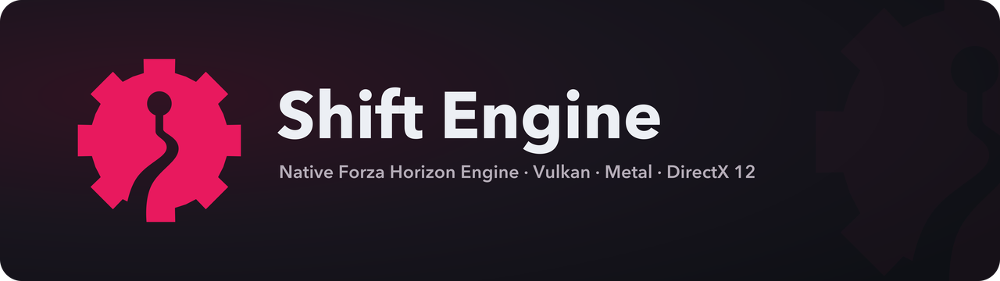

<p align="center">
  
</p>

# Shift Engine

A native C++20 clean-room engine (Vulkan 1.3, Metal 3, DirectX 12) for playing your own copy of *Forza Horizon* (2012, Xbox 360) on Windows, Linux, the Steam Deck, Apple Silicon Macs, and Android.

[Download](https://github.com/arcanite24/pinyon-shift-native/releases/latest) · [Documentation](https://arcanite24.github.io/pinyon-shift-native/) · [Install guide](docs/player/INSTALL.md) · [Modding](docs/player/MODS.md) · [Benchmarks](docs/BENCHMARK.md)

## Bring your own disc

This repository and its release packages contain **only independently written engine source code, tools, and compiled shaders**. They do **not** contain the game, extracted assets, executable modules, generated translations, or any copyrighted game data.

- **You supply your own game files.** Point the launcher or setup script at your *Forza Horizon* retail `.iso` image or extracted disc folder (`media/` and `default.xex`), and optionally your own Title Update v4 and DLC STFS packages.
- **Nothing is downloaded or uploaded.** Setup indexes your files locally into your user data folder, streams vehicles directly from disc without modifying your disc folder or the repository, and imports existing saves strictly read-only.
- **Clean-room boundary.** All code here is written from format and behavioral specifications, never from disassembly, decompiled output, or recompiled guest code. Every commit is checked by `tools/check-provenance.py`, and release packages can be checked against your game tree with `tools/check-binary-content.py`.

Not affiliated with or endorsed by Microsoft, Xbox, Turn 10 Studios, or Playground Games.

## Supported platforms

| Platform | Graphics API | Packaging | Notes |
| --- | --- | --- | --- |
| Windows 10 / 11 (x64) | Vulkan 1.3 / DirectX 12 | Portable `.zip` with `shift-launcher.exe` | Tested on NVIDIA RTX, AMD Radeon, and Intel integrated GPUs |
| Linux / Steam Deck (x86-64) | Vulkan 1.3 (RADV / NVIDIA) | `.zip` with `shift-launcher` + Steam shortcut | Requires glibc 2.38+ (SteamOS 3.7+, Ubuntu 24.04+) |
| macOS 13.3+ (Apple Silicon) | Metal 3 / Vulkan via MoltenVK | `Shift Engine.app` bundling `libMoltenVK.dylib` | Unsigned bundle; approve once in System Settings |
| Android 10+ (arm64, API 29+) | Vulkan 1.1+ (system or Mesa Turnip) | `shift-drive-arm64.apk` (launcher-first + Wi-Fi Sync) | On-device ISO/STFS/mod setup, save manager, touch HUD, and full gamepad support |

## Quick start (players)

1. Download the release archive for your platform from [GitHub Releases](https://github.com/arcanite24/pinyon-shift-native/releases/latest) and verify its checksum against `SHA256SUMS.txt`.
2. Unpack the archive and launch **`shift-launcher`** (`shift-launcher.exe` on Windows, `./shift-launcher` on Linux, or `Shift Engine.app` on macOS).
3. On the **Setup** tab, drop or browse your `.iso` image or extracted disc folder (containing `media/`) and click **Run Setup**. Setup verifies your disc and builds the compact Colorado world index — vehicles stream directly from disc with no multi-gigabyte car bake required.
4. *(Optional)* Use the **Saves** tab to manage career profiles or import an existing save read-only from **PinyonShift** / Horizon 1 exports, **Content** to drag-and-drop Title Update v4 / Rally / 1000 Club / DLC STFS packages, **Mods** / **Radio** / **Controls** to customize your install, or **Android** to sync files over local Wi-Fi.
5. Configure your graphics preset, resolution, window mode, backend, VSync, and FPS cap on the **Play** tab (kept bidirectionally in sync with in-game `settings.txt`) and click **Play**.

Prefer the command line? Run setup directly:

```powershell
# Windows (PowerShell)
.\setup.ps1 D:\fh1\disc
```

```sh
# Linux / macOS
./setup.sh ~/fh1/disc
```

See [docs/player/INSTALL.md](docs/player/INSTALL.md) and the [Install documentation](https://arcanite24.github.io/pinyon-shift-native/install/) for Portable Mode, Steam Deck Gaming Mode, macOS shortcuts, Android on-device setup & Wi-Fi Sync, and wheel/controller configuration.

## Building from source

### Prerequisites

- **CMake 3.25+** and **Ninja**
- **C++20 compiler:** MSVC 2022 (Windows), GCC 13+ or Clang 17+ (Linux), Apple Clang / Xcode Command Line Tools (macOS), or Android NDK r27+ (Android)
- **Git** (CMake `FetchContent` pulls pinned dependencies listed in [THIRD_PARTY_NOTICES.md](THIRD_PARTY_NOTICES.md))
- **No Vulkan SDK required:** Vulkan headers, `volk`, and `VulkanMemoryAllocator` are fetched automatically, and prebuilt SPIR-V shaders live in `apps/carview/shaders/prebuilt/`. If `glslangValidator` or `glslc` is installed, shaders are compiled from source automatically.

### Windows

```powershell
.\tools\build-windows.ps1
ctest --test-dir build -LE corpus --output-on-failure
```

### Linux

Install X11/Wayland, audio, and development headers for SDL3 (on Ubuntu/Debian: `cmake ninja-build build-essential pkg-config libx11-dev libxext-dev libxrandr-dev libxcursor-dev libxi-dev libxfixes-dev libxss-dev libwayland-dev libxkbcommon-dev libasound2-dev libpulse-dev libdbus-1-dev libudev-dev`), then:

```sh
cmake -S . -B build -G Ninja -DCMAKE_BUILD_TYPE=Release
cmake --build build
ctest --test-dir build -LE corpus --output-on-failure
```

### macOS (Apple Silicon)

```sh
brew install cmake ninja molten-vk
cmake -S . -B build -G Ninja -DCMAKE_BUILD_TYPE=Release
cmake --build build
ctest --test-dir build -LE corpus --output-on-failure
```

### Android (arm64 APK)

Requires Android SDK (API 35 platform and build-tools), Android NDK r27+, and JDK 11+:

```sh
cmake -S . -B build-android -G Ninja -DCMAKE_BUILD_TYPE=Release \
  -DCMAKE_TOOLCHAIN_FILE="$ANDROID_NDK_HOME/build/cmake/android.toolchain.cmake" \
  -DANDROID_ABI=arm64-v8a -DANDROID_PLATFORM=android-29 \
  -DSHIFT_BUILD_LAUNCHER=OFF
cmake --build build-android --target carview
python3 tools/android-apk.py --build build-android
```

`android-apk.py` automatically bundles the open-source Mesa Freedreno Turnip driver in `assets/drivers/turnip/` (loaded rootlessly on Qualcomm Adreno GPUs via `libadrenotools` with `TU_DEBUG=sysmem` and Adreno GPU Turbo, with automatic fallback to the system Vulkan driver on non-Adreno GPUs or when **System** is selected in the launcher). Built-in Android graphics presets cover all three mobile targets: **Low Power** (540p + VRS, 512px textures, lowest RAM/VRAM), **Performance 120** (720p CAS + VRS, 120 Hz display lock + ADPF), **Smooth 60** (720p CAS + 2x MSAA + VRS, 60 Hz), **Quality 30** (native 1080p, 2x MSAA, shadows, GTAO, volumetric fog), and **Best Graphics** (`ultra`, native 1080p OLED showcase with SSR, high shadows/PCSS, GTAO, contact shadows, hex-tiling, and car clearcoat detail).

See the [Building guide](https://arcanite24.github.io/pinyon-shift-native/building/) for shader regeneration, corpus tests, and packaging (`tools/package.py`).

## Repository layout

| Path | Contents |
| --- | --- |
| `libs/fh1data` | Format readers: FH1 ZIP/LZX archives, `.xds` textures, `.carbin` models, Colorado geometry/PVS/materials, `.bgf`/`.bsg`/`.fbf` UI scenes, vector fonts |
| `libs/data` | Game database rules and event restriction decoding (`gamedb.slt`, opened read-only) |
| `libs/cars` | Install resolver (disc, Title Update v4, DLC), merged car catalog, direct-from-disc & `.shiftbake` loader, mod overlay |
| `libs/drive` | Car physics, suspension/tyres, driving assists, rewind buffer, driving line, AI drivers, cameras, rumble/wheel/DualSense input |
| `libs/world` | Colorado world streaming, collision, time-of-day sky, smashables, world animations |
| `libs/audio` | Engine sound synthesis, FSB4/XMA2 parsing, radio scheduler (`dr_mp3`), voiceover, acoustics |
| `libs/traffic`, `libs/freeroam`, `libs/race` | Road network and traffic, collectibles/barn finds/outposts/PR stunts, race modes, Rally, and 1000 Club |
| `libs/garage`, `libs/profile` | Garage, upgrades/tuning/PI, livery/paint, multi-profile career saves, backups, read-only PinyonShift/Xenia import, LAN save sync |
| `libs/rhi` | Multi-backend graphics abstraction (Vulkan 1.3, DirectX 12, Metal 3) |
| `libs/setup` | Clean-room GDFX/XISO extractor, STFS (v4/DLC) installer, mod & Mesa Turnip installer, zero-bake world indexer |
| `apps/carview` | Main engine runtime (`carview`), GPU-driven world renderer, UI4 renderer, benchmark harness, and Android launcher-first app (`SetupActivity` + `DriveActivity`) |
| `apps/launcher` | Native SDL3 + Vulkan cross-platform GUI launcher (`shift-launcher`) with synced settings, save manager, PinyonShift import, custom radio builder, controls calibration, updater, and Android Wi-Fi Sync |
| `apps/carbake`, `apps/soundbake`, `apps/profile-import` | Optional offline car baker, engine audio baker, and save import CLI tools |
| `assets/branding` | Shift Engine vector marks, app icon, Windows `.ico`, and macOS `.icns` |
| `tests/` | Synthetic-data unit tests (`ctest -LE corpus`) and optional local-disc corpus tests |
| `tools/` | Setup, packaging (`package.py`, `android-apk.py`), benchmarks (`benchmark.py`), shader regeneration, provenance/binary checks |
| `site/` | Zero-dependency static documentation site generator (`python site/build.py`) |

## Contributing, security, and licence

- **Contributing:** Read [CONTRIBUTING.md](CONTRIBUTING.md) before opening a pull request — in particular the clean-room rule and required checks.
- **Security:** Report vulnerabilities privately via [SECURITY.md](SECURITY.md).
- **Licence:** Independently written code in this repository is licensed under the [GNU General Public License v3.0 or later](LICENSE). Third-party libraries fetched at build time are listed in [THIRD_PARTY_NOTICES.md](THIRD_PARTY_NOTICES.md).
